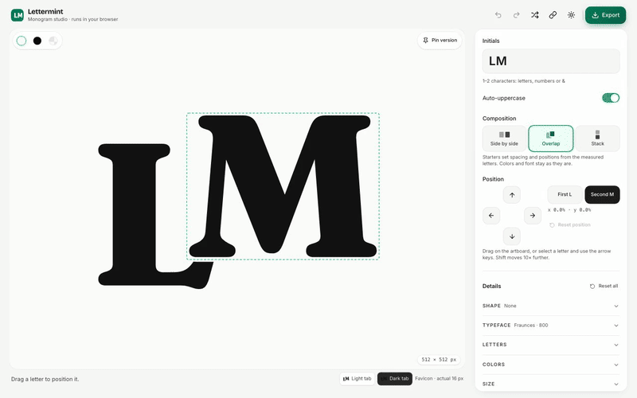
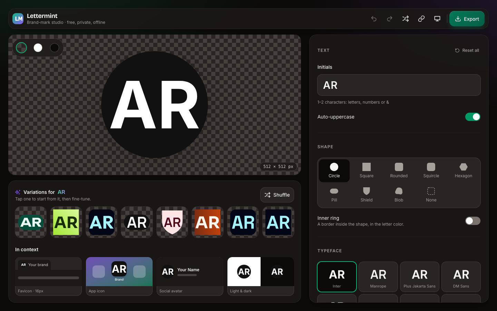
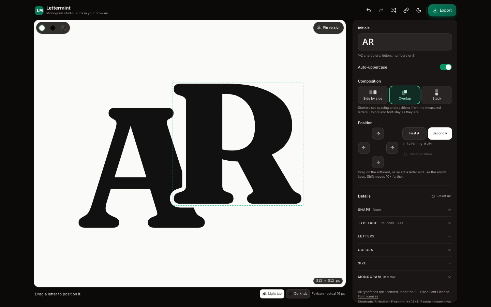
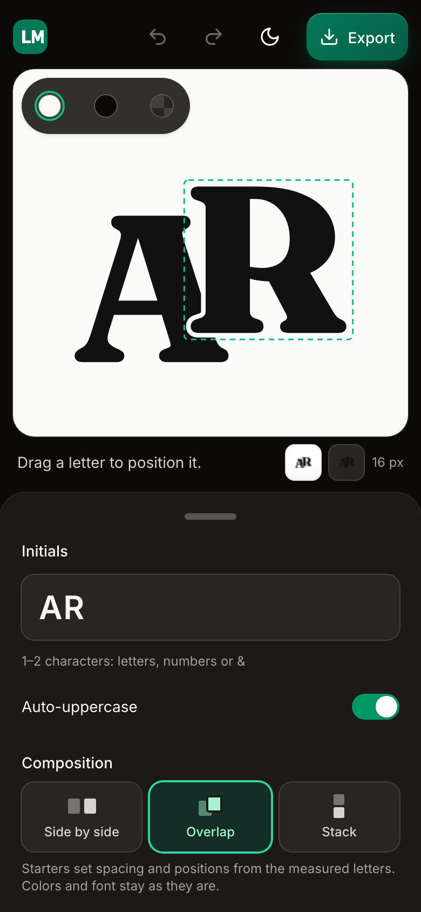
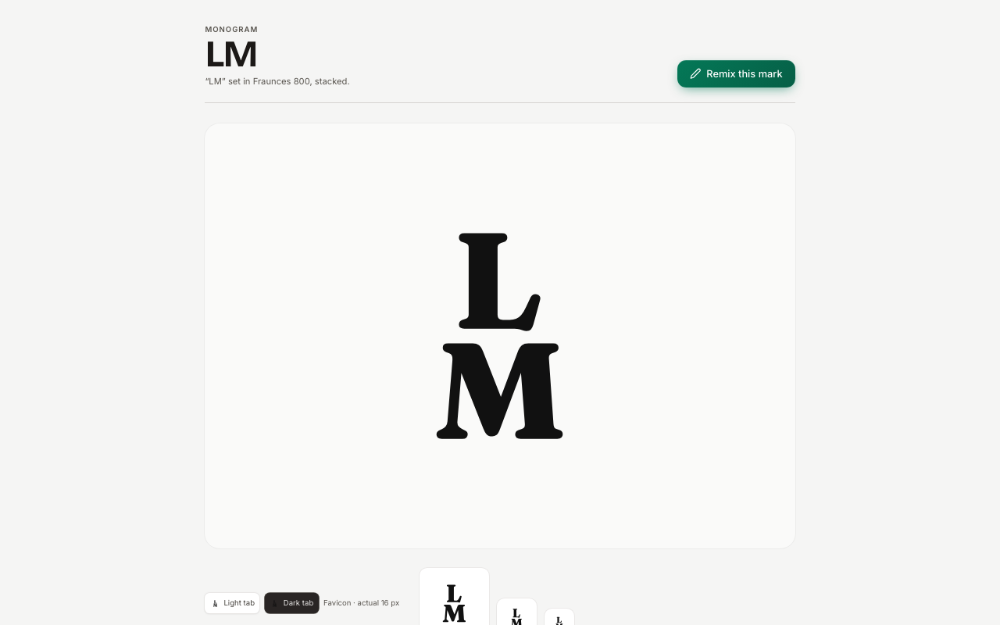

# Lettermint: free initials logo maker

**Type your initials, pick a composition, drag a letter into place, check the real 16 px favicon, and export exactly what you see. Free, no signup, runs entirely in your browser.**

Live: **https://lettermint-tau.vercel.app/**



The clip is assembled from real screenshots of the running app. Each frame was taken after a real input event (keystrokes, clicks and a mouse drag sent over the Chrome DevTools Protocol). The frames were then retimed to a human pace; [MP4 version](docs/evidence/demo-type-compose-drag-export.mp4).

### Before and after

Same viewport (1440 × 900, dark theme) and the same initials, **AR**:

| Before | After |
| --- | --- |
|  |  |

| Mobile, 390 px | Presentation link |
| --- | --- |
|  |  |

## Features

- **Composition on the mark.** Three starters (Side by side, Overlap, Stack) are placed from the *measured* ink of the two letters, so narrow (II), wide (MW) and mixed (AR) pairs all get the same visual relationship. Overlap cuts a small gap into the first letter where the second crosses it, so the two letters never merge into one blob.
- **Direct editing.** Click or tap a letter to select it, then drag it with a mouse, pen or finger. Letters snap to the canvas center and to each other's center, and a guide line shows the snap (hold Alt/Option for free placement). Each drag is one undo step. Keyboard users select “First A” or “Second A” and move it with the arrow keys (Shift moves 10 times further). A tappable direction pad does the same.
- **Real favicon.** The exported SVG is rasterised to a 16 × 16 PNG, the same file as the kit's `favicon-16.png`. It is shown at its actual size in a light and a dark browser tab next to the artwork.
- **Compare.** Pin a version, keep editing, and flip between Pinned and Current at the same size. *Restore pinned* is a single undo step.
- **Presentation links.** A share link with a portfolio masthead, the finished mark and its favicon. *Remix this mark* opens the same composition in the editor.
- **Live editor.** One or two characters, 12 self-hosted typefaces in up to five weights, eight shapes (circle to seeded blob) or none, solid or gradient fills, outline letters, inner ring, letter spacing, and per-letter rotation and shift for monograms.
- **Styles gallery.** Type your initials once and browse ten named designs drawn from them (an interlocking serif, a stacked column, an open pair, a ringed seal, mixed-typeface pairs and more), filtered by Serif, Sans, Framed or Mixed type. Each tile is the real renderer, and the editor opens on exactly the tile you picked. *Styles* takes you back with your initials, filter and scroll position intact.
- **Per-letter type.** Each letter of a pair can have its own typeface and weight, the second letter its own size and colour, and either letter can sit in front. Share links from before this change open with one typeface, as they were drawn.
- **Mockups.** The mark as a browser tab favicon, iOS app icon, social avatar, and on light and dark backgrounds.
- **Contrast check.** A WCAG ratio for letters against the shape, including the weakest pair of gradient stops.
- **Export.** SVG, or PNG from 64 to 2048 px. You can also copy the SVG markup.
- **Brand kit (ZIP).** `favicon.ico`, PNG icons (16 to 512 px), an Apple touch icon, a 1200×630 OG image, `site.webmanifest`, horizontal and stacked name lockups (text converted to paths), and a generated palette as `palette.css` and `tailwind.config.js`.
- **Never lose work.** Undo/redo (`⌘/Ctrl+Z`), autosave, and a share link that rebuilds the exact logo from the URL. Links from before letter positioning still open exactly as they did.
- **Private and offline.** No server and no tracking. After the first visit the app works offline, and logo fonts are cached as you use them.
- **Accessible.** Keyboard-operable controls with visible focus, 44 px touch targets, live announcements for copy and download, and AA text contrast in light and dark themes.

## Tech stack

React 18 · TypeScript (strict) · Vite 8 · Tailwind CSS 4 · Zustand · opentype.js · vite-plugin-pwa (Workbox) · Vitest · ESLint

Letters are drawn from the font outlines with opentype.js, so every export is plain SVG paths with no font dependency. The ZIP and ICO writers are small hand-written modules (`src/lib/zip.ts`, `src/lib/ico.ts`), not libraries.

### Engineering note: why the preview and the exported SVG always match

There is one composition and one serializer. `buildLogo()` (`src/lib/buildLogo.ts`) turns the state into geometry. It lays the letters out in font units, fits them to the canvas, and then moves each letter by its offset. Offsets are stored as fractions of the canvas side (1/10000), not as screen pixels, so resizing the window or changing the canvas size keeps the composition. `logoSvgBody()` (`src/lib/svg.ts`) turns that geometry into SVG markup. The artboard, the gallery, the mockups, the 16 px favicon, the SVG and PNG downloads and every file in the brand kit all render that same markup. The editing layer is a separate transparent SVG with the same `viewBox` on top of the mark. It converts pointer positions to logo coordinates with the same `xMidYMid meet` math the browser uses (`clientToLogo` in `src/lib/compose.ts`). Selection outlines and snap guides live only in that layer, so they can never leak into an export. A browser check confirms that the path data on screen and in the downloaded SVG are identical, and that the kit's `logo.svg` is byte-identical to the SVG download.

## Run it

Requires Node 20.19+ or 22.12+.

```bash
npm install
npm run dev       # http://localhost:5173
npm run test      # unit tests (Vitest)
npm run lint
npm run build     # type-check + production build into dist/
npm run preview   # serve the production build
```

### Deploy (Vercel)

Import the repo. Vercel detects Vite: the build command is `npm run build` and the output directory is `dist`. No `vercel.json` is needed, because all state lives in the URL hash and there are no server routes.

#### Site URL

The canonical link, Open Graph and Twitter image URLs, `robots.txt` and `sitemap.xml` all come from one build-time value, `VITE_SITE_URL`. When it is unset, the build uses the default in `src/lib/site.ts` (`https://lettermint-tau.vercel.app`). The value must be a bare origin such as `https://lettermint.vercel.app`, with no path; anything else fails the build. `robots.txt` and `sitemap.xml` are generated into `dist/` by `npm run build`, so `npm run dev` does not serve them.

To set it in Vercel:

1. Open the project in the Vercel dashboard, then **Settings → Environment Variables**.
2. Add the key `VITE_SITE_URL` with your production origin, for example `https://lettermint.vercel.app`. Tick **Production** (add **Preview** only if previews should point at their own URL).
3. Save, then redeploy (**Deployments →** latest **→ Redeploy**). The value is read at build time, so existing deployments keep the old URL.

The CLI equivalent is `vercel env add VITE_SITE_URL production`, then `vercel deploy --prod`. Locally, run `VITE_SITE_URL=https://… npm run build`.

## Project layout

```
src/lib/        pure, unit-tested logic: geometry, SVG, palette, brand kit, ZIP, ICO, share links
src/store/      Zustand stores; every write goes through one validator
src/components/ rendering only
docs/PLAN.md    roadmap and design decisions
```

## What I learned

- **Keep logic pure and the UI thin.** Geometry, SVG serialisation, palette maths, share-link parsing and the ZIP writer are plain functions with tests. The components only render, which kept each phase from breaking the previous one.
- **Validate at one boundary.** URL hashes, localStorage and gallery picks all go through the same validator before they reach the renderer. A damaged or hostile share link therefore can't crash the app. It shows a message instead.
- **Fonts as data, not CSS.** opentype.js cannot read WOFF2, so the logo fonts ship as WOFF and load only when they are used. Converting glyphs to paths means an exported SVG looks identical everywhere.
- **The file formats are small.** A stored ZIP and a PNG-in-ICO each take about 50 lines. That beat adding a dependency for one feature.
- **Modal dialogs hide everything else from screen readers.** A toast outside a `showModal()` dialog is never announced, so the export dialog has its own live region.
- **Contrast needs checking in both themes.** The mint primary button and the gradient heading text passed in the design but measured below 4.5:1. Both now use darker stops.
- **Measure before optimising.** Lighthouse and the network panel showed that eight gallery fonts were competing with the main preview. They now wait until the selected font is ready, and the export code loads only when the dialog opens.
- **SVG shapes ignore `touch-action`.** On a phone the browser started panning and cancelled every letter drag. A non-passive `touchstart` listener now claims only touches that begin on a letter, so the rest of the artboard still scrolls.
- **Version the share format.** New links carry `v=2`. Older links lack the new position fields, so they get the values the old renderer used, not the visitor's autosave. A test pins this, and a browser check shows an old link drawing the same path data as the live site.

## Measured results

Local measurements, not production analytics.

| Measure | Before | After | Method |
| --- | --- | --- | --- |
| Actions to reposition the second letter | 3, and only along the slider axes (scroll the settings column, drag *Letter spacing*, drag *Second letter shift*) | 1 (drag the letter) | Counted in the live site and the new build at 1440 × 900. In the old build both sliders sit below the fold (y ≈ 1090 and 1454 px). |
| First complete monogram, cold load (median of 5) | 4161 ms | 4033 ms | Production builds of the previous commit and this one, served locally. Same Chrome, 1440 × 900, cache and service worker bypassed, 150 ms RTT / 1.6 Mbps, 4× CPU throttle. Time from navigation start until the main mark's glyph path is in the DOM. Raw runs: [first-mark-timings.json](docs/evidence/first-mark-timings.json). The two defaults use different fonts (Inter 700 before, Fraunces 800 after), and the difference is inside the run-to-run spread. Read it as "no regression". |

---

Not affiliated with lettermint.co.
