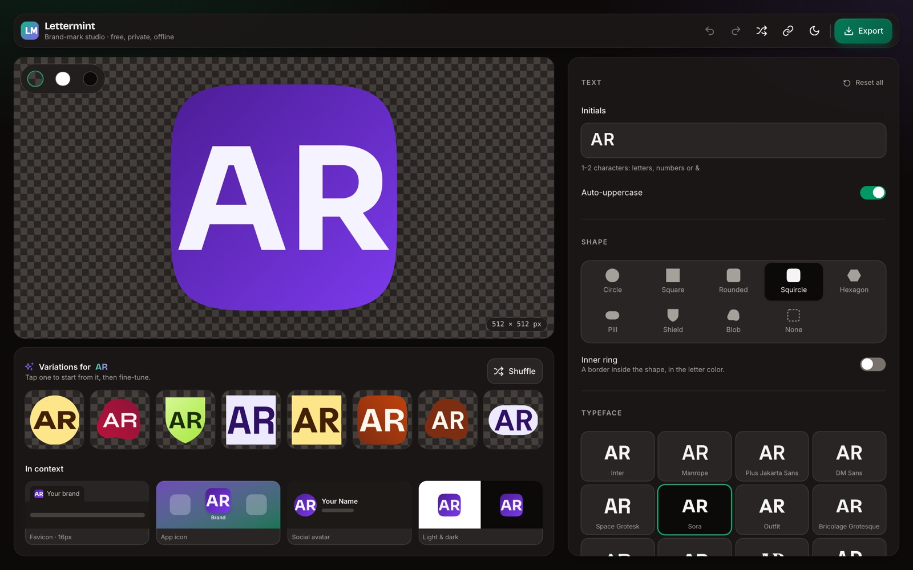
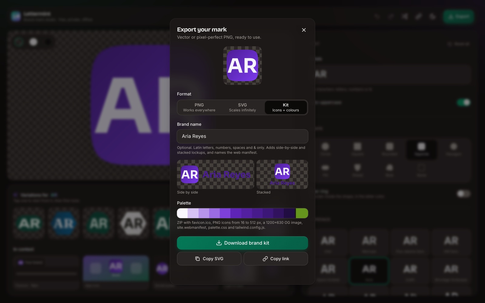
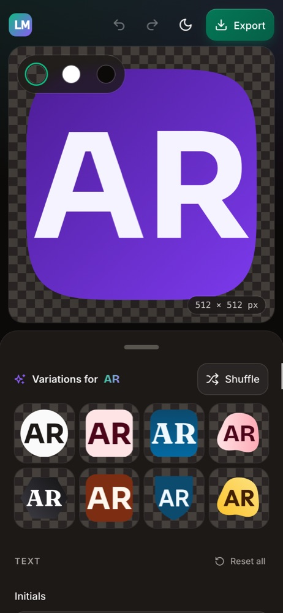

# Lettermint

**Type your initials, get a brand mark and a ready-to-use brand kit. Free, no signup, runs entirely in your browser.**



| Brand kit export | Mobile |
| --- | --- |
|  |  |

## Features

- **Live editor.** One or two characters, 12 self-hosted typefaces in up to five weights, eight shapes (circle to seeded blob) or none, solid or gradient fills, outline letters, inner ring, letter spacing, and per-letter rotation and shift for monograms.
- **Variations.** Eight alternatives built from your own initials. Click one to apply it, or press `R` to shuffle.
- **Mockups.** The mark as a browser tab favicon, iOS app icon, social avatar, and on light and dark backgrounds.
- **Contrast check.** A WCAG ratio for letters against the shape, including the weakest pair of gradient stops.
- **Export.** SVG, or PNG from 64 to 2048 px. You can also copy the SVG markup.
- **Brand kit (ZIP).** `favicon.ico`, PNG icons (16 to 512 px), an Apple touch icon, a 1200×630 OG image, `site.webmanifest`, horizontal and stacked name lockups (text converted to paths), and a generated palette as `palette.css` and `tailwind.config.js`.
- **Never lose work.** Undo/redo (`⌘/Ctrl+Z`), autosave, and a share link that rebuilds the exact logo from the URL.
- **Private and offline.** No server and no tracking. After the first visit the app works offline, and logo fonts are cached as you use them.
- **Accessible.** Keyboard-operable controls with visible focus, 44 px touch targets, live announcements for copy and download, and AA text contrast in light and dark themes.

## Tech stack

React 18 · TypeScript (strict) · Vite 8 · Tailwind CSS 4 · Zustand · opentype.js · vite-plugin-pwa (Workbox) · Vitest · ESLint

Letters are drawn from the font outlines with opentype.js, so every export is plain SVG paths with no font dependency. The ZIP and ICO writers are small hand-written modules (`src/lib/zip.ts`, `src/lib/ico.ts`), not libraries.

## Run it

Requires Node 20.19+ or 22.12+.

```bash
npm install
npm run dev       # http://localhost:5173
npm run test      # unit tests (Vitest)
npm run lint
npm run build     # type-check + production build into dist/
npm run preview   # serve the production build
```

### Deploy (Vercel)

Import the repo. Vercel detects Vite: the build command is `npm run build` and the output directory is `dist`. No `vercel.json` is needed, because all state lives in the URL hash and there are no server routes.

Before launch, replace the placeholder domain `https://lettermint.example.com` in `index.html`, `public/robots.txt` and `public/sitemap.xml`.

## Project layout

```
src/lib/        pure, unit-tested logic: geometry, SVG, palette, brand kit, ZIP, ICO, share links
src/store/      Zustand stores; every write goes through one validator
src/components/ rendering only
docs/PLAN.md    roadmap and design decisions
```

## What I learned

- **Keep logic pure and the UI thin.** Geometry, SVG serialisation, palette maths, share-link parsing and the ZIP writer are plain functions with tests. The components only render, which kept each phase from breaking the previous one.
- **Validate at one boundary.** URL hashes, localStorage and gallery picks all go through the same validator before they reach the renderer. A damaged or hostile share link therefore can't crash the app. It shows a message instead.
- **Fonts as data, not CSS.** opentype.js cannot read WOFF2, so the logo fonts ship as WOFF and load only when they are used. Converting glyphs to paths means an exported SVG looks identical everywhere.
- **The file formats are small.** A stored ZIP and a PNG-in-ICO each take about 50 lines. That beat adding a dependency for one feature.
- **Modal dialogs hide everything else from screen readers.** A toast outside a `showModal()` dialog is never announced, so the export dialog has its own live region.
- **Contrast needs checking in both themes.** The mint primary button and the gradient heading text passed in the design but measured below 4.5:1. Both now use darker stops.
- **Measure before optimising.** Lighthouse and the network panel showed that eight gallery fonts were competing with the main preview. They now wait until the selected font is ready, and the export code loads only when the dialog opens.
